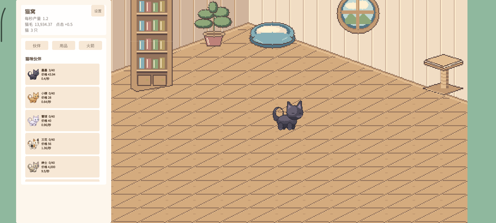
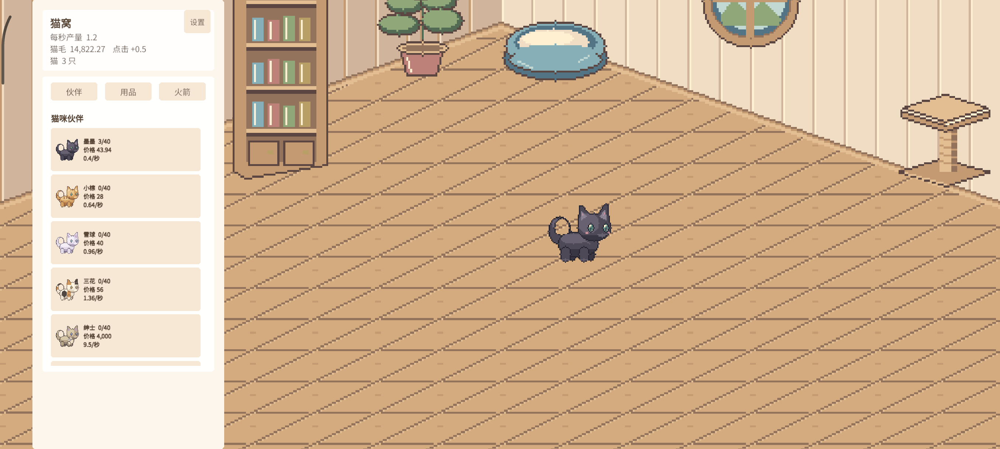

# Android 超宽屏背景修复与回归

2026-11-13。承接[真机首轮验收](android-phone-test-evidence.md)，普通 v3 APK 在小米 22081212C / Android 15、2712×1220、LandscapeLeft 下右侧出现 156 px 相机底色。本轮把显示缺陷转为投影单元回归和实际 Appium 红绿对照，未更改猫咪素材或经济数值。

## 缺陷、根因与修复

编号 M15，优先修复，影响超宽屏画面完整性，未阻断购买或保存。`CatWorld.FitWindow` 在 Pixel Perfect Camera 启用时固定按正交半高 5.4 计算背景尺寸。已安装的 Pixel Perfect 5.0.3 则按实际高度和整数缩放倍率计算：2712×1220 的半高为 6.1、2560×1440 为 7.2，背景因而覆盖不足。

修复按当前高度、PPU 和整数倍率计算背景覆盖，保留原相机模式。公开游戏目录候选提交 `0076ec5`；本地完整工程先保存为 `36e0cba`，后续 Appium 用例为 `d4a1d55`。这些本地测试提交不属于公开纯游戏仓库历史。单元测试在提交前工作区执行，随后保存相同测试/玩法代码；versionCode 从 3 调为 4 是后续构建元数据变更。

## 执行过程和保留的失败

下列路径均相对 [`evidence/android/viewport/`](../evidence/android/viewport/)。真实执行与静态核验分开计数，未将 Robot dry-run 作为设备测试。

| 步骤 | 实际结果 | 证据 |
|---|---|---|
| 首次旧算法回归 | 两种尺寸覆盖失败，另有 EditMode 手工 SendMessage 初始化引擎断言，不能将全部失败算成游戏 Bug | `editmode-red.xml` |
| 修正测试初始化，仍用旧算法 | 5/7，通过的五项和失败的 2712×1220、2560×1440 均保留 | `editmode-red-02.xml` |
| 修复后全量第 1、2 次 | 均为 EditMode 61/62；7 个覆盖用例通过，唯一失败是已有千次存档压力用例 | `EditMode.xml`、`EditMode-02.xml` |
| 隔离存档压力用例 | 原断言、1000 次存读及中途主档损坏恢复，1/1，通过用时 11911 ms | `save-isolated-01.xml` |
| 全量第 3 次及 PlayMode | EditMode 62/62、PlayMode 87/87，均无跳过，退出码 0；未加入等待或重试换取通过 | `EditMode-03.xml`、`PlayMode-01.xml`、`test-exits-03.json` |
| 普通 APK 第 1 次构建 | SDK 查询直连等待，代理属性未出现在目标 Java 进程；保存诊断后主动取消，CLI 退出 6 | `release-v4/build-01-cancelled.txt` |
| 普通 APK 第 2 次构建 | SDK 脚本支持的 JAVA_OPTS/SDKMANAGER_OPTS 传入本次代理后，CLI/编辑器退出 0 | `release-v4/CatGame-Android.provenance.json`、`artifact.json` |
| 真机旧 v3，同一 Appium 用例 | 菜单→继续→离线弹窗→待播 CG→三猫房间；右侧检查 `[156,156,156]`，用例失败，退出 1 | `phone-v3-red-01/` |
| v3→v4 覆盖安装 | 安装前先 Home 落盘；首次启动前主档字节完全相同，三猫、点击 2；安装 APK 与本地哈希一致 | `phone-upgrade-v4/` |
| 真机 v4，同一 Appium 用例 | 菜单与继续成功、三猫恢复，检查 `[0,0,0]`，1/1，退出 0；人工复核画面边缘 | `phone-v4-01/` |
| 独立 API 34 AVD 三比例 | 专用用户 10，显式两猫布局数据；1600×900、2000×900、1200×900 均 `[0,0,0]`，3/3，退出 0 | `avd-v4-01/` |

七种投影尺寸：1600×900、2000×900、1200×900、1920×1080、2712×1220、2560×1440、3840×2160。单元测试调用实际 `FitWindow`，独立调用已安装 Pixel Perfect 包的投影计算作比较，避免按游戏公式再写一份相同预期。实际设备截图核对用于补足引擎内尺寸断言的边界。

## 截图对照

同一手机原生尺寸，三条扫描线分别位于高度 35%、50%、75%；每条从右边缘检测连续相机底色。没有把三条采样线当作所有像素的检查。

v3，右侧 156 px：

v4，右侧 0 px：

截图内容是测试过程中正常存档的自然/离线收入，余额变化不是注入。AVD 的两猫数据则是明确注入的布局前置，不代表自然购买。测试未向手机普通版写入存档。

## 构建与来源

- APK：versionCode 4 / versionName 1.0，ARM64，minSdk 22 / targetSdk 32，普通非 Development 包，111702778 字节。
- SHA-256：`bbd62c49d9e97be964933e13ab72cbc7bdc2a14645cf849ca92f7f92d39edf80`。
- 使用与 v3 相同的 Android Debug 证书，可覆盖安装。属于不上架的预览包，不声明满足商店当前上架要求。
- Unity 2022.3.21f1、CLI 1.0.0。CLI 自带 provenance 不含 Git 字段，需结合 `artifact.json`、候选源码和代码哈希阅读；构建日志的许可证校验警告未隐藏。
- 测试代码见 [RoomViewportTests](../harness/Assets/Tests/EditMode/RoomViewportTests.cs)、[手机用例](../harness/android/phone_viewport.robot)、[AVD 用例](../harness/android/android_room_viewport.robot) 和 [边缘检查](../harness/android/check_room_coverage.py)。游戏源码、测试证据分别发布，APK 不提交本仓库。

## 未关闭事项与结论边界

> 2026-11-14 后续：下段“QA v4 正在构建、尚未复采”为上轮快照。QA v4 已完成六轮真机采样，21810 帧均在预算内，六张测量后截图边缘均为 0；[详细结果](android-v4-performance.md)。百猫挂机与发行交付另行更新。

普通版显示修复已通过上述范围。独立 `.perf` v4 正在构建，背景复查和性能复采尚未完成；不将 v3 的六轮性能结果直接作为 v4 测量结果。Android 源码和 Release 交付另行完成。

M16 跟踪 Windows 间歇存档 I/O：第二轮第 874 次 `File.Replace` 返回 HResult `0x80070497`，主档、备份和临时文件均存在。随后两次通过不能证明根因已解决；未归因于杀毒软件，也未将其描述成已复现的 Android 丢档。生产 SaveNow 保持 dirty 并延后重试，测试静态 SaveToPath 仍抛出异常。失败导出能力仅在指定诊断目录保留文件后重新抛出，不吞异常。[Microsoft 1175 返回值说明](https://learn.microsoft.com/en-us/windows/win32/api/winbase/nf-winbase-replacefilew)。

原 M14 模拟器偶发购买恢复问题仍未定位，历史失败继续保留。本轮没有扩展到其他机型、另一握持方向、耗电或长期稳定性。独立 AVD 使用只读实例和专用用户；MuMu 未被写入测试数据或改动显示尺寸。

运行 `python verify_evidence.py` 可重新核对红绿结果、截图摘要/尺寸、覆盖安装字节与 APK 哈希、既有负例和最终回归结果。该命令核验已有材料，不会新跑游戏。

## 2026-11-14 发行交付追加

[Android 预览版](https://github.com/Creepercao/CatGame/releases/tag/android-v1.0.0-preview.1)已公开，普通 APK 目标源码 `0076ec5`，三个附件为 APK、Install-Android.txt 与 SHA256SUMS.txt。服务端摘要和大小均与本地一致；Windows v1.0.0 仍为 latest。发布元数据见 `evidence/android/viewport/release-published.json`。QA v4 六轮性能和 301.97 秒挂机均已完成，详细数据见 [v4 性能复验](android-v4-performance.md)。原 M14/M16 跟踪和全部负例继续保留，不因发行而改为已修复。
